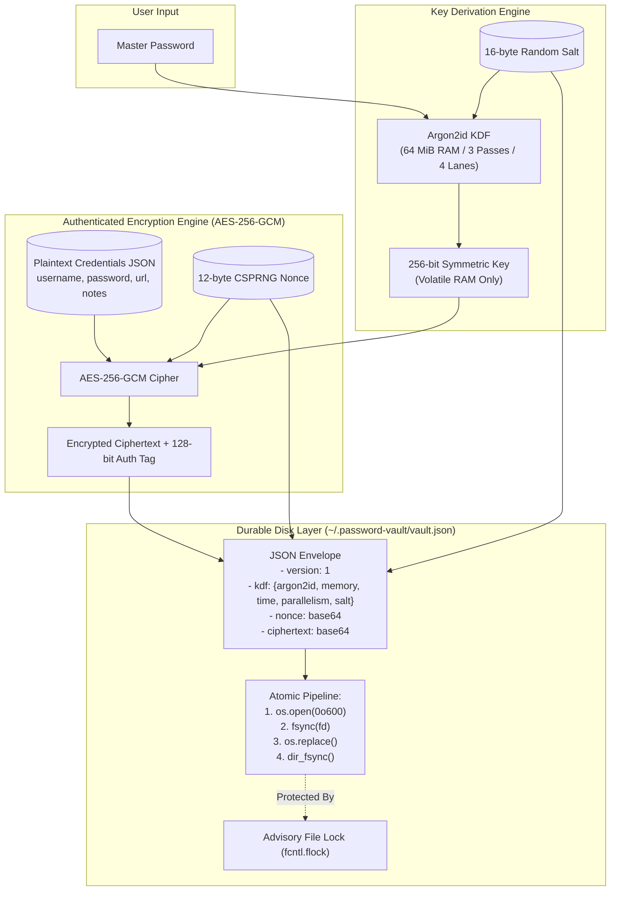

# 🔐 PASS VAULT (`pv`)

[](https://www.python.org/)
[](#cryptographic-architecture)
[-brightgreen.svg)](tests/)
[](tests/)
[](#security-model)
[](LICENSE)

> A modern, zero-knowledge, encrypted command-line password manager engineered with defense-in-depth. Built with **Argon2id** memory-hard key derivation, **AES-256-GCM** authenticated encryption, crash-resilient atomic storage, and POSIX concurrency locks.

---

## 🌟 Key Highlights

- **Zero-Knowledge Architecture**: Your master password never touches disk, is never cached in shell history, and is never logged. A high-entropy 256-bit AES key is derived in-memory on demand and destroyed upon process exit.
- **Argon2id Key Derivation**: Hardened against GPU and ASIC cluster attacks using OWASP-aligned parameters (`64 MiB RAM`, `3 passes`, `4 lanes`, `16-byte salt`). Each derivation intentionally takes ~0.5s, making offline brute-force cracking computationally prohibitive.
- **AES-256-GCM Authenticated Encryption**: Guarantees confidentiality, integrity, and authenticity. Every save generates a brand-new cryptographically secure 96-bit nonce.
- **Anti-Oracle Tamper Resistance**: A wrong master password and a modified/tampered vault file produce the exact same cryptographic verification failure (`WrongPasswordError`). Refusing to differentiate between the two eliminates attack oracles.
- **Crash-Safe Atomic Persistence**: Employs a strict durability pipeline (`tmp write` $\to$ `fsync` $\to$ `atomic replace` $\to$ `parent-dir fsync`). Your vault is never left in a corrupted or half-written state if a crash or power failure occurs.
- **Zero Chmod Race Window**: Temporary files are created with Unix permission `0o600` directly at the `os.open` system call, ensuring files are never world-readable even for a fraction of a millisecond.
- **Concurrent-Safe Advisory Locking**: Uses `fcntl.flock(LOCK_EX)` on a sidecar lockfile to serialize racing background operations and multi-terminal access.
- **CSPRNG Password Generator**: Powered by Python's `secrets` module and an unbiased in-place Fisher-Yates (Knuth) shuffle driven by `secrets.randbelow`.
- **Developer-Friendly & Pipe-Ready**: Clean stdout/stderr separation enables piping passwords directly into clipboards or shell scripts (`pv gen 32 | pbcopy`).
- **Rich Terminal UI**: Displays credentials in cleanly styled tables and colored panels without leaking sensitive data to terminal scrollback.

---

## 🏗️ Architecture & Cryptographic Flow



---

## ⚡ Quick Start

### 1. Installation

Clone the repository and run the setup script:

```bash
git clone https://github.com/AtharvaShastrakar/Password-Manager.git
cd "Password-Manager"
./install.sh
```

*(Alternatively, use `just` or standard `pip`)*:
```bash
python3 -m venv .venv
source .venv/bin/activate
pip install -e .
```

### 2. Initialize Your Vault

Create a new encrypted vault (defaults to `~/.password-vault/vault.json`):

```bash
pv init
# Or with command runner: just run -- init
```
```text
New master password: ************
Confirm master password: ************
Vault created at /Users/you/.password-vault/vault.json
```

### 3. Add an Entry

Store a credential. Passwords can be typed manually (hidden prompt) or randomly generated on the fly with `-g`:

```bash
pv add github -g
```
```text
Username for github: atharva
URL (optional, press Enter to skip): https://github.com
Notes (optional, press Enter to skip): Main developer account
Generated strong random password for github
Added entry: github
```

### 4. Retrieve an Entry

View credential details inside an authenticated terminal panel:

```bash
pv get github
```
```text
┌────────────────── github ──────────────────┐
│ username  atharva                          │
│ password  u8#K9$xL2!mP9vQ3@rZ              │
│ url       https://github.com               │
│ notes     Main developer account           │
│ created   2026-10-13T10:45:00+00:00        │
│ updated   2026-10-13T10:45:00+00:00        │
└────────────────────────────────────────────┘
```

### 5. List All Stored Entries

Inspect stored vault keys without exposing passwords:

```bash
pv list
```
```text
┏━━━━━━━━━━┳━━━━━━━━━━┳━━━━━━━━━━━━━━━━━━━━┳━━━━━━━━━━━━━━━━━━━━┓
┃ Name     ┃ Username ┃ URL                ┃ Last Updated       ┃
┡━━━━━━━━━━╇━━━━━━━━━━╇━━━━━━━━━━━━━━━━━━━━╇━━━━━━━━━━━━━━━━━━━━┩
│ github   │ atharva  │ https://github.com │ 2026-10-13 10:45:0 │
│ proton   │ contact  │ https://proton.me  │ 2026-10-13 10:50:1 │
└──────────┴──────────┴────────────────────┴────────────────────┘
```

---

## 🛠️ CLI Command Reference

| Command | Purpose | Flags / Options |
| :--- | :--- | :--- |
| `pv init` | Creates a new encrypted vault file | `--force` (overwrite existing) |
| `pv add <name>` | Adds a new credential entry | `-g` / `--generate` (create random password)<br>`--overwrite` (replace existing entry) |
| `pv get <name>` | Authenticates and displays an entry | None |
| `pv list` | Lists all entry names and metadata | None (passwords never displayed) |
| `pv delete <name>` | Removes an entry by name | None |
| `pv gen [length]` | Generates an unbiased CSPRNG password | `[length]` (default 20)<br>`--no-symbols`<br>`--no-digits` |
| `pv change-password` | Rotates master password under fresh salt and key | None |

> [!NOTE]
> All commands accept `--vault <path>` (or the `$PV_VAULT` environment variable) to point to an alternate vault file.

---

## 🛡️ Security Architecture & Mitigations

| Threat Vector | Defense Mechanism in PASS VAULT |
| :--- | :--- |
| **Vault File Theft** | Stored ciphertext is encrypted with **AES-256-GCM**. Decryption key is derived with **Argon2id** (64 MiB RAM, 3 passes, 4 lanes). A billion brute-force guesses would take $\approx$ 15 years on modern hardware. |
| **Tampered Vault File** | AES-GCM's 128-bit authentication tag immediately detects any bit-flips or byte alterations. Decryption fails securely with zero plaintext leakage. |
| **Authentication Oracle Attacks** | The application returns the exact same error (`WrongPasswordError`) whether the password is incorrect or the file was tampered with, preventing adversaries from using the tool as an oracle. |
| **Power Loss Mid-Write** | Uses an atomic rename sequence: `tmp file -> fsync -> os.replace -> parent-dir fsync`. The file system always guarantees 100% old content or 100% new content—never partial writes. |
| **Process Race Conditions** | Concurrent `pv` executions are serialized via advisory `fcntl.flock(LOCK_EX)` on a sidecar `.lock` file. |
| **Unsafe Temporary Permissions** | Temporary files are created with `0o600` at the very first syscall (`os.open`), avoiding the race condition inherent in `open() -> chmod()`. |
| **Predictable RNG** | All salts, nonces, and generated passwords strictly query the OS cryptographic entropy pool via `secrets`. The predictable `random` module is never used. |
| **Aging KDF Parameters** | KDF parameters are stored in the vault envelope and verified against strict algorithmic minimums on load. Running `pv change-password` seamlessly upgrades existing vaults to newer OWASP parameters. |
| **Process / History Snooping** | Master passwords are **never accepted as CLI flags** (e.g., `-p` is rejected). Sensitive inputs are gathered exclusively via `getpass.getpass()`, preventing leaks into `~/.bash_history` and `ps aux`. |

---

## 💻 Pipe-Friendly Scripting Examples

Because `pv gen` separates interactive logging (stderr) from raw password output (stdout), you can integrate it directly with your shell workflows:

```bash
# Copy a 32-character password directly to the macOS clipboard
pv gen 32 | pbcopy

# Copy to Linux clipboard (X11)
pv gen 32 | xclip -selection clipboard

# Capture password directly into a script variable
NEW_PASS=$(pv gen 24 --no-symbols)

# Generate alphanumeric-only passwords
pv gen 20 --no-symbols
```

---

## 🧪 Testing & Code Quality

PASS VAULT is backed by a comprehensive automated test suite with **71 unit and integration tests**:

```bash
# Run pytest across crypto, vault, generator, and CLI modules
just test

# Run tests with test coverage breakdown
just test-cov

# Run linting and syntax checks
just lint
```

### Coverage Overview:
- `passvault.exceptions`: **100%**
- `passvault.generator`: **100%**
- `passvault.crypto`: **97%**
- `passvault.ui`: **97%**
- `passvault.config`: **96%**
- `passvault.vault`: **90%**
- `passvault.cli`: **79%**
- **Total Suite Coverage**: **88%**

---

## 📚 In-Depth Learning Modules

For students, researchers, and engineers exploring cryptography and systems programming, comprehensive guides are available in the [`learn/`](learn/) directory:

- [**01 - Cryptographic Concepts & Security Model**](learn/01-CONCEPTS.md): Memory-hardness theory, AEAD mathematics, anti-oracle principles, and §12: What this project does not defend against (threat boundaries).
- [**02 - System Architecture & File Storage**](learn/02-ARCHITECTURE.md): Envelope specification, the atomic fsync durability pipeline, and POSIX concurrency locks.
- [**03 - Codebase Walkthrough**](learn/03-WALKTHROUGH.md): An in-depth code tour detailing each function, class, and design choice.

---

## 📄 License

This project is licensed under the [MIT License](LICENSE).
Built with secure coding standards for local credential management.
