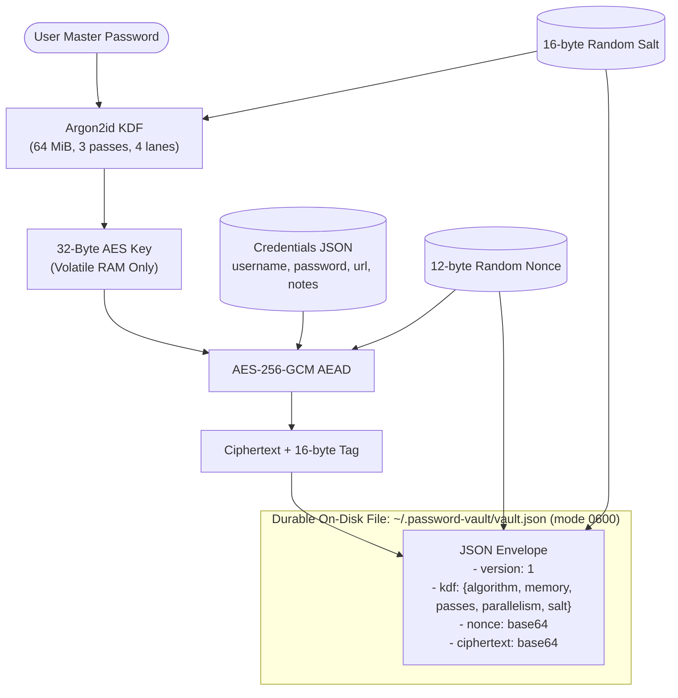
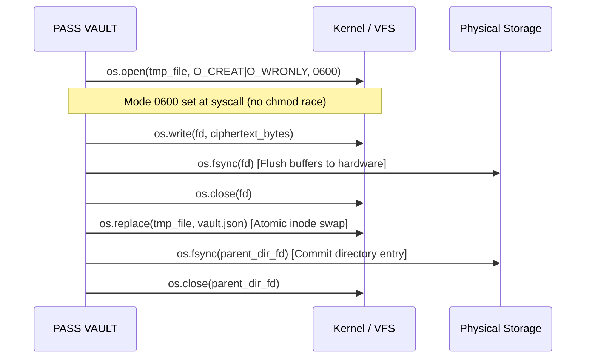
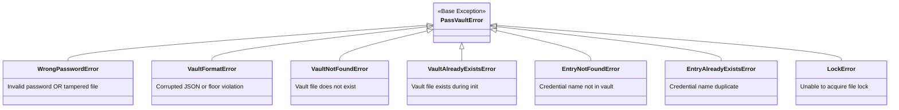

# 02 - System Architecture & File Format

This document details the architectural layout, serialization envelopes, and POSIX concurrency guarantees implemented in **PASS VAULT (`pv`)**.

---

## 1. High-Level System Architecture



---

## 2. On-Disk Vault Envelope Schema

The vault is persisted as an ASCII-encoded JSON envelope with strict permission `0o600`.
Notice that no credential plaintext, master password, or derived key is stored here.

```json
{
  "version": 1,
  "kdf": {
    "algorithm": "argon2id",
    "salt": "base64_encoded_16_bytes_salt==",
    "memory_cost": 65536,
    "time_cost": 3,
    "parallelism": 4,
    "hash_len": 32
  },
  "nonce": "base64_encoded_12_bytes_nonce==",
  "ciphertext": "base64_encoded_ciphertext_and_16_byte_auth_tag=="
}
```

### Decrypted Internal Payload
Once authenticated and decrypted with the derived key, the payload contains:

```json
{
  "entries": {
    "github": {
      "username": "dev_user",
      "password": "k9#V!mP8$xL2@qZ4",
      "url": "https://github.com",
      "notes": "Primary development account",
      "created": "2026-10-13T10:00:00+00:00",
      "updated": "2026-10-13T10:00:00+00:00"
    }
  }
}
```

---

## 3. Atomic, Durable Write Pipeline

To ensure the vault file is never left in a corrupted or half-written state during sudden power loss or process crashes, `passvault.vault._atomic_write_file` implements this exact sequence:



---

## 4. Advisory File Locking

Concurrent invocations of `pv` (e.g. background automation or multiple open terminal windows) could race to update `vault.json`.

PASS VAULT handles this using POSIX advisory locking on a sidecar file:
`~/.password-vault/vault.json.lock`.

```python
with acquire_vault_lock(vault_path):
    # Lock is held exclusively via fcntl.flock(lock_fd, fcntl.LOCK_EX)
    # Perform read -> decrypt -> modify -> encrypt -> atomic_write
    # Lock is safely released in finally block via fcntl.flock(lock_fd, fcntl.LOCK_UN)
```

---

## 5. Typed Exception Hierarchy


